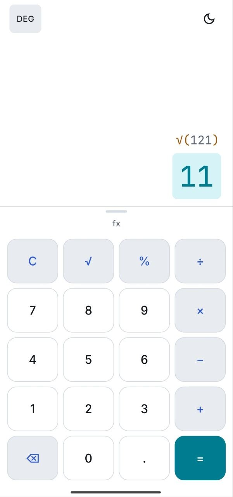
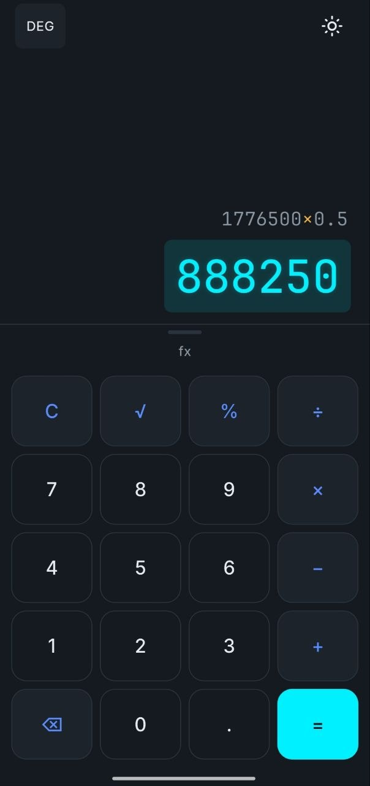
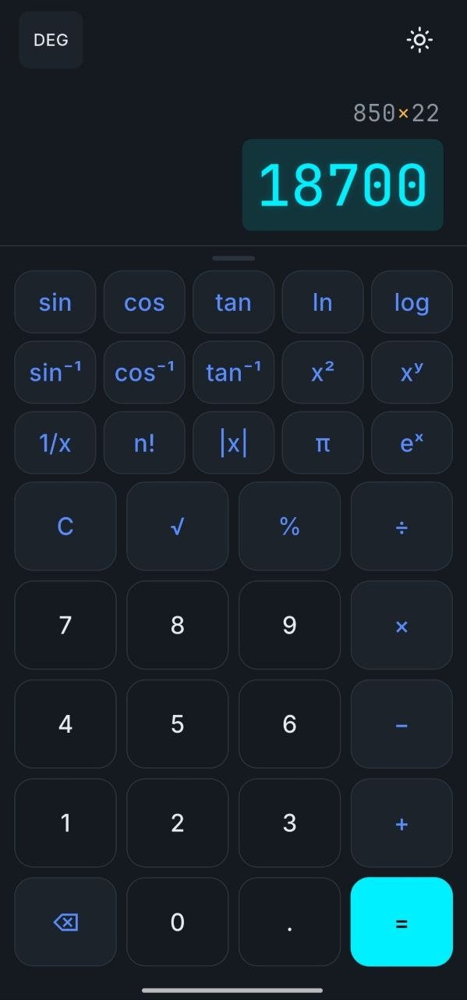

# Calc App - built with Flutter

Calc App is a modern calculator built with Flutter, designed to provide both standard and scientific calculations through a clean, responsive and distraction-free interface.

## Features

* **Basic calculations:** addition, subtraction, multiplication and division
* **Scientific functions:** sine, cosine, tangent, logarithms, natural logarithms, powers and roots
* **Inverse functions:** inverse trigonometric operations for advanced calculations
* **Additional operations:** factorial, reciprocal, absolute value and percentage calculations
* **Degree mode:** perform trigonometric calculations using degrees
* **Light and dark themes:** switch between themes directly from the calculator
* **Expandable scientific panel:** access advanced functions only when needed
* **Real-time expression display:** view both the current expression and the calculated result
* **Offline:** all calculations are performed locally on the device
* **Cross-platform:** built with Flutter and designed to run on supported Flutter platforms

## Privacy

Calc App runs entirely on your device.

No data is sent to a server, uploaded to the cloud or stored remotely. The app does not require an account or an internet connection to perform calculations.

Built by RebelTailor. All rights reserved.

## Screenshots

